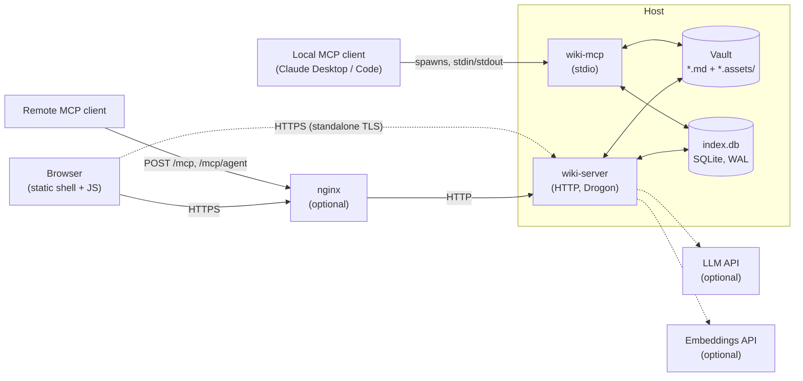
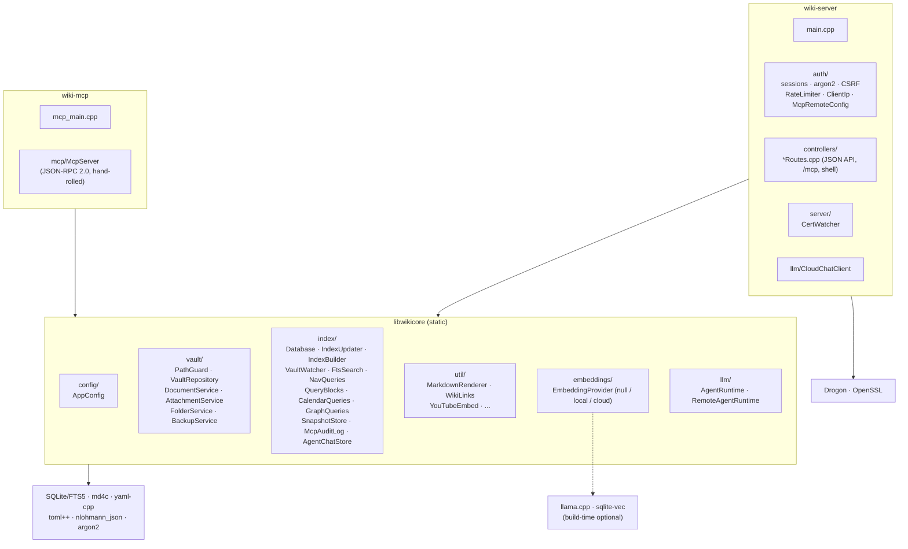
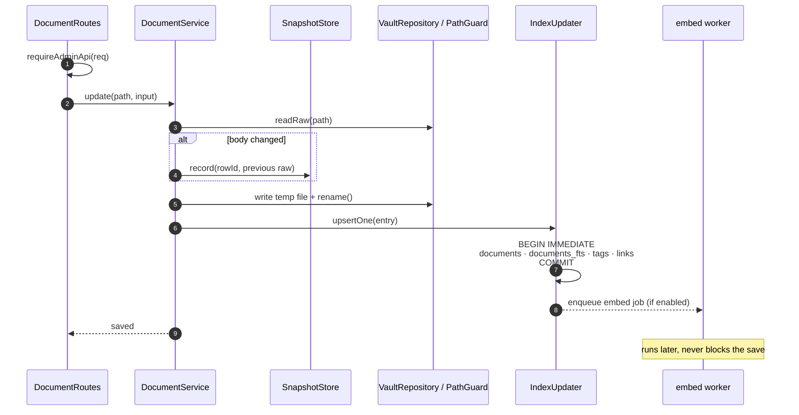
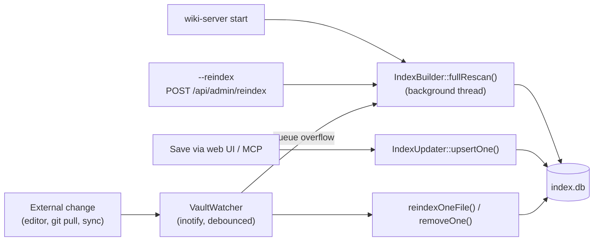
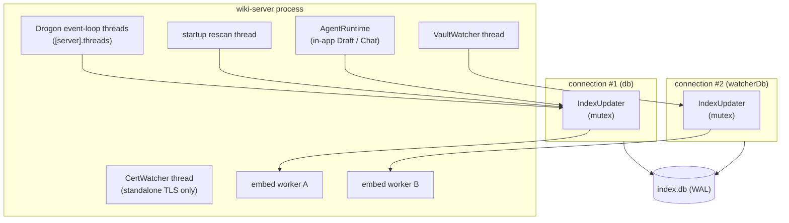
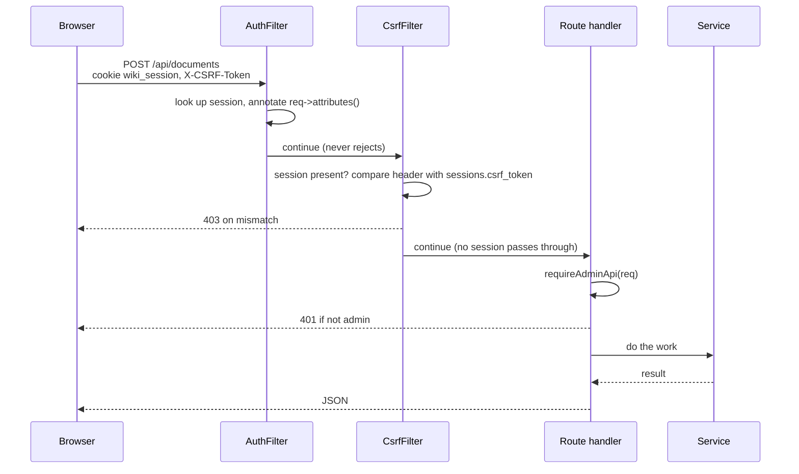
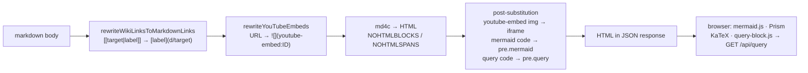
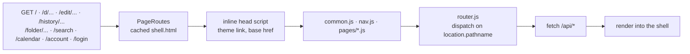
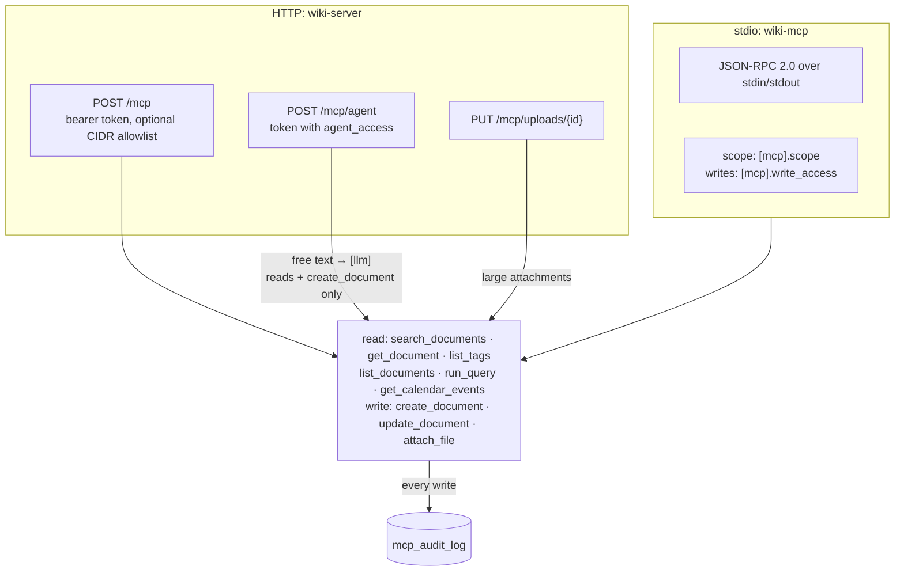
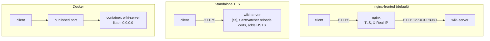

# Architecture

A map of how the wiki is put together: what runs, where data lives, which
thread touches what, and where the trust boundaries are. The first two
sections are the overview; the rest goes one level deeper, for someone about
to change the code.

Related reading: [`behavior.md`](behavior.md) (user-visible guarantees),
[`mcp.md`](mcp.md), [`llm.md`](llm.md), [`embeddings.md`](embeddings.md),
[`sbc-deployment.md`](sbc-deployment.md), [`docker.md`](docker.md).

## Overview



- **The vault is the data.** Every document is a markdown file with YAML
  front matter; attachments sit next to it in `<stem>.assets/`. Backing up
  the vault is backing up the wiki.
- **The SQLite index is a disposable cache.** Search, navigation, tags,
  backlinks and embeddings all live in `index.db` and can be rebuilt from the
  vault at any time (`wiki-server --reindex`, or simply a restart). The same
  file also holds data the vault does not (admin account, sessions, remote
  MCP tokens, audit log, agent chats, document version history), which is
  why a corrupt db is rebuilt with those rows copied across rather than
  simply deleted.
- **One admin, no roles.** Anonymous visitors see public documents only; the
  admin sees and edits everything.
- **The wiki is an MCP server**, not an MCP client. LLM clients connect to it.
  The only outbound calls it makes are the optional `[llm]` and
  `[embeddings]` providers.

## Two-binary layout

Both executables link one static library, `libwikicore`. Anything web-only
(sessions, CSRF, Drogon filters, TLS) stays out of it, so `wiki-mcp` starts
fast and carries no HTTP stack.



| Binary | Entry point | Rescans vault at startup | Auth |
|---|---|---|---|
| `wiki-server` | `src/main.cpp` | Yes, in the background, every start | Admin session + CSRF for the web UI; bearer tokens for `/mcp` |
| `wiki-mcp` | `src/mcp_main.cpp` | No: it trusts the existing index | None per request; spawning the process is the trust boundary |

`libwikicore` has no Drogon dependency. It links OpenSSL only when the cloud
embedding provider is compiled in (`WIKI_ENABLE_CLOUD_EMBEDDINGS`), for that
provider's outbound HTTPS. Markdown rendering in it is DB-free:
`MarkdownRenderer` has no database handle, and anything that needs live data
at view time (` ```query ` blocks) is fetched client-side.

## Storage model

### Writing a document

`vault::DocumentService` is the only code path that writes a document. Disk
first, index second, so the index never describes content that didn't land.



Deletes are soft: the document and its `.assets/` folder move to `.trash/`
at the same relative path. Renames and moves re-path the existing index row
(so history survives) and rewrite inbound `[[wiki-links]]` and asset
references in other documents.

### Keeping the index current



The startup rescan is what correctness relies on. `VaultWatcher` is
best-effort: it normally picks up an external change within about a second,
and anything it misses is reconciled by the next rescan.

### What lives in `index.db`

The schema is compiled into the binary (`src/index/schema.h`), not shipped
as `.sql` files, so nothing depends on a runtime resource path.

| Area | Tables |
|---|---|
| Documents and search | `documents`, `documents_fts` (FTS5), `tags`, `document_tags`, `document_links`, `attachments`, `todo_items`, `link_items`, `index_meta` |
| History | `document_snapshots` |
| Auth | `users`, `sessions` |
| Remote MCP | `mcp_remote_config`, `mcp_remote_allowed_cidrs`, `mcp_remote_tokens`, `mcp_audit_log` |
| Semantic search | `document_embeddings` (sqlite-vec, created at runtime), `document_embedding_state`, `embedding_chunk_progress`, `embeddings_runtime_config` |
| In-app agent | `agent_chats` |

The document/search tables and the embedding vectors are derived from the
vault and rebuilt by a rescan. The rest (credentials, sessions, MCP config
and tokens, audit log, snapshots, chats, the vector-search toggle) exists
only in the database; `Database::ensureUsable()` salvages the admin account
and MCP config if it has to quarantine a corrupt file.

### Filesystem access is centralized

`vault::PathGuard` canonicalizes every inbound path and rejects anything that
resolves outside the vault root (traversal, symlink escapes).
`VaultRepository` is the only class that uses it, and everything else
(services, controllers, MCP tools) goes through `VaultRepository`. No other
code builds a vault-relative `std::filesystem::path` of its own.

## Threads and SQLite connections



- Request threads, the startup rescan and the in-app agent share connection
  #1. Its `IndexUpdater` holds a mutex around each `BEGIN IMMEDIATE…COMMIT`,
  because two threads opening a transaction on one `sqlite3*` handle is an
  error, not a wait.
- Each `IndexUpdater` owns one lazily started embedding worker. The two
  workers share a claim on `(document, content hash)`, so a save followed by
  its own inotify event embeds once, not twice.
- On shutdown, queued embedding jobs are dropped (the next startup rescan
  re-queues them); a document being embedded stops after its current chunk.

### VaultWatcher gets its own Database

`VaultWatcher` writes through connection #2, never the request threads'
connection. Two connections to one WAL-mode file are coordinated by SQLite
at the file level; one connection shared across threads is not.
`VaultWatcher::start()` returns only after the initial recursive
`inotify_add_watch()` pass completes, so no change in the startup gap is
lost.

`wiki-mcp` opens one connection of its own and never computes embeddings:
its `IndexUpdater` is constructed without a provider.

## Request handling and auth



- **Filters annotate; handlers decide.** `AuthFilter` never blocks a request
  and `CsrfFilter` lets a session-less request through. The actual gate is
  `requireAdminApi(req)` as the first line of every mutating handler. A
  filter listed on a route does not by itself mean the route is protected;
  `tests/integration/security_e2e.py` checks the real behavior over HTTP.
- Filters are referenced by their fully qualified name
  (`"wikicore::auth::AuthFilter"`), and `main.cpp` calls each filter's
  `classTypeName()` so Drogon registers it. A wrong name fails at runtime
  (`middleware ... not found`), not at build time.
- The CSRF token is stored server-side in `sessions.csrf_token` and delivered
  through a non-HttpOnly `wiki_csrf_token` cookie, which the frontend echoes
  in the `X-CSRF-Token` header. The cookie is only a delivery channel.
- A successful login always issues a fresh session token; a pre-set cookie
  is never adopted.
- Client IP for rate limiting and the remote-MCP allowlist comes from
  `auth::clientIp()`. Proxy headers are trusted only when `[tls].enabled` is
  false, i.e. when nginx is in front; in standalone TLS mode the peer address
  is used.

### Visibility is fail-safe-private

`visibility` in front matter is `public` or `private`; anything missing or
malformed is `private`. An anonymous request for a private document gets
`404`, not `403`, so its existence isn't revealed. The same gate applies to
every read path: `/d/`, `/assets/`, search, navigation tree, tag counts (a
tag used only by private documents is absent, not zero), graph, calendar,
query blocks and MCP tools. Each MCP tool re-checks the resolved document's
own `visibility` on top of the query filter.

The one deliberate exception is stdio `wiki-mcp`, whose `[mcp].scope`
defaults to `admin` (public and private): whoever can spawn it locally
already has filesystem access to the vault.

## Content rendering pipeline



- Raw HTML in markdown is disabled at the parser
  (`MD_FLAG_NOHTMLBLOCKS`/`SPANS`). That flag is the sanitization; there is
  no separate pass.
- Embeds follow a marker-then-substitute pattern: a pre-pass turns a
  construct into inert CommonMark, md4c renders it, and only the exact tag
  md4c produced is swapped for real markup. A hand-typed `` is escaped by md4c and can't forge one. YouTube
  IDs are validated at both ends.
- Search snippets use control bytes (`\x01`/`\x02`) as FTS5 match markers.
  The renderer escapes the whole snippet first and only then turns the
  control bytes into `<mark>`.
- Content security headers on every response are a backstop for the parser
  flag, not a substitute.

## Frontend

The backend is a JSON API. There is no server-side templating.



- Every page URL returns the same `static/shell.html`, read once at startup
  and cached in the process (`PageRoutes.cpp`). `base_path` and the theme
  list are injected into it at that point; replacing the file on disk needs a
  restart.
- Navigation is a full page reload; there is no History API routing.
  `router.js` picks a page renderer from `static/js/pages/` by path.
- Static files are served only from `static/`, never the project root.
- Stylesheets are injected by script after `<base>` is set, so relative URLs
  resolve against the mount root under any `base_path`.
- Themes are self-contained files in `static/css/themes/`, discovered at
  startup. Adding one is adding a file.
- Vendored client libraries (Toast UI Editor, mermaid.js, Prism, KaTeX) are
  committed and load lazily, only on pages that use them.

## MCP

Both transports expose the same tool implementations and the same query
engines as the HTTP API (`QueryBlocks::parseAndRun`,
`CalendarQueries::eventsBetween`). Details and client configuration are in
[`mcp.md`](mcp.md).



### stdio transport

`wiki-mcp` speaks JSON-RPC 2.0 directly (`src/mcp/McpServer.cpp`, no MCP
library). Notifications (no `id`) never get a response. It never rescans the
vault; run `wiki-server` (or `--reindex`) to keep the index current.

### Remote MCP transport (HTTP)

`POST /mcp` is hand-built in `RemoteMcpRoutes.cpp` and toggled at runtime
from the Account page (state in SQLite, no restart). Tokens are stored as
SHA-256 hashes, labeled per client, and revocable individually; token
comparison is constant-time across every row. Remote write access has its
own switch, independent of `[mcp].write_access`. `enabled`, write access and
the IP allowlist are global; the only per-token setting is `agent_access`.

`POST /mcp/agent` hands free text to the configured `[llm]`, which may read,
search and call `create_document`, but never `update_document` or
`attach_file`. It uses its own `CloudChatClient`, separate from the in-app
agent's.

## LLM agents

Optional, enabled by `[llm]` ([`llm.md`](llm.md)).

| | In-app Draft / Chat | Remote agent |
|---|---|---|
| Code | `llm/AgentRuntime` | `llm/RemoteAgentRuntime` |
| Caller | Admin in the web UI | Bearer token with `agent_access` |
| Transport | `/api/agent/sessions`, SSE stream | `POST /mcp/agent`, single request |
| State | Sessions persisted in `agent_chats` | Stateless, one turn |
| Chat client | Shared, single-flight, cancellable | Its own instance |

## Semantic search (embeddings)

Optional at build time and at runtime ([`embeddings.md`](embeddings.md)).
`EmbeddingProviderFactory` picks `null`, `local` (llama.cpp, GGUF model) or
`cloud` (OpenAI-compatible API). Documents are split into passages, each
passage is embedded on the background worker, and vectors go into a
sqlite-vec table whose dimension is fixed at creation; switching models
drops and recreates it. `FtsSearch` merges FTS5 and nearest-neighbour results
by reciprocal rank fusion. Full-text search never depends on embeddings
being available.

## Build & Deployment

Dependencies come from vcpkg in manifest mode with a pinned baseline. Our
own code and light dependencies link statically; on a normal build libc,
libstdc++ and OpenSSL stay dynamic. The cross-compiled ARM build is fully
static (musl, via zig), see the "Cross-compilation" section of
[`sbc-deployment.md`](sbc-deployment.md).



| Shape | Where documented |
|---|---|
| systemd on a single host or SBC, backup timer | [`sbc-deployment.md`](sbc-deployment.md) |
| Build, deploy and secrets automation | [`wiki-ops.md`](wiki-ops.md) |
| Container | [`docker.md`](docker.md) |

`cmake --install build --prefix <dir>` produces the runnable tree: `bin/`,
`static/`, `config.example.toml` and the systemd units.
